# CSE201 Term Project (Fall 2026) — ATM System 최종 보고서 (초안)

> 이 파일은 초안입니다. `TODO`로 표시한 부분은 직접 채워야 합니다.
> 기준 코드: `prototype` branch. 코드가 바뀌면 2·5·7절을 다시 확인하세요.

---

## 1. Team Members

| 이름 | 학번 | 역할 |
|---|---|---|
| TODO | TODO | TODO |
| TODO | TODO | TODO |

---

## 2. Final Class Diagram

아래 Mermaid 코드는 VS Code(Markdown Preview Mermaid Support 확장) 또는 GitHub에서 그림으로 보입니다.
보고서(Word/PDF)에는 그림으로 캡처하거나 export해서 넣으세요.

표기: `<|--` 상속, `*--` 소유(`unique_ptr`, 수명 같이함), `o--` 공유(`shared_ptr`), `-->` 참조(포인터·참조, 소유 아님)

```mermaid
classDiagram
    direction LR

    class System {
        -ConsoleIO io_
        -TransactionLog log_
        -vector~unique_ptr~Bank~~ banks_
        -vector~unique_ptr~ATM~~ atms_
        +promptAndLoad()
        +load(filename)
        +printAdminCards(out)
        +run()
        +printSnapshot(out)
        +findBank(name) Bank*
        +findCard(number) Card*
        +findAccount(number) Account*
    }

    class Bank {
        -string name_
        -vector~unique_ptr~Account~~ accounts_
        -map~string, Account*~ accountIndex_
        -map~string, unique_ptr~Card~~ cards_
        +openAccount(owner, number, balance) Account&
        +issueCard(number, account, password) UserCard&
        +issueAdminCard() AdminCard&
        +supplyCash(atm, cash)
        +findCard(number) Card*
        +findAccount(number) Account*
        +verifyPassword(card, password) bool
    }

    class Account {
        -Bank* bank_
        -string ownerName_
        -string accountNumber_
        -long long balance_
        -vector~shared_ptr~Transaction~~ history_
        +deposit(amount)
        +withdraw(amount)
        +addHistory(tx)
        +balance() long long
    }

    class Card {
        <<abstract>>
        -string number_
        -Bank* issuer_
        +canBeUsedAt(atm)* bool
        +isAdmin()* bool
        +asUserCard() UserCard*
    }
    class UserCard {
        -Account* account_
        -string password_
        +canBeUsedAt(atm) bool
    }
    class AdminCard {
        +canBeUsedAt(atm) bool
    }

    class ATM {
        <<abstract>>
        -string serial_
        -Bank* primaryBank_
        -bool bilingual_
        -CashBundle cash_
        -int maxBills_
        +startSession(system)
        +acceptsBank(bank)* bool
        +isPrimary(bank) bool
        +typeName()* string
        +acceptCash(bills)
        +planDispense(amount, out) DispenseResult
        +dispenseCash(bills)
        -authenticate(system, card, msg) bool
        -runAdminSession(system, msg)
        -runUserSession(system, card, msg)
    }
    class SingleBankATM {
        +acceptsBank(bank) bool
    }
    class MultiBankATM {
        +acceptsBank(bank) bool
    }

    class Session {
        -ATM* atm_
        -UserCard* card_
        -const Messages* msg_
        -int withdrawCount_
        -vector~shared_ptr~Transaction~~ txs_
        +run()
        -handleDeposit()
        -handleWithdrawal()
        -handleTransfer()
        -process(tx)
        -printSummary()
    }

    class Transaction {
        <<abstract>>
        -static int nextId_
        -int id_
        -string atmSerial_
        -string cardNumber_
        -long long amount_
        -long long fee_
        +execute(atm)
        +describe(msg)* string
        +affectedAccounts()* vector~Account*~
        #validate(atm)* 
        #apply(atm)*
    }
    class DepositTransaction {
        <<abstract>>
        -Account* target_
        -CashBundle feeBills_
        +requiredFee(atm, target)$ long long
    }
    class CashDepositTransaction {
        -CashBundle bills_
    }
    class CheckDepositTransaction
    class WithdrawalTransaction {
        -Account* source_
        -CashBundle dispensed_
        +requiredFee(atm, source)$ long long
    }
    class CashTransferTransaction {
        -Account* dest_
        -CashBundle inserted_
        +requiredFee()$ long long
    }
    class AccountTransferTransaction {
        -Account* source_
        -Account* dest_
        +requiredFee(atm, source, dest)$ long long
    }

    class TransactionLog {
        -vector~shared_ptr~Transaction~~ entries_
        +add(tx)
        +printForAtm(out, msg, serial)
        +saveForAtm(path, msg, serial) bool
    }

    class CashBundle {
        -array~int,4~ counts_
        +totalBills() int
        +totalAmount() long long
        +add(other)
        +remove(other)
        +planDispense(amount, maxBills, out) DispenseResult
    }

    class FeePolicy {
        <<utility>>
        +depositFee(primary)$
        +withdrawalFee(primary)$
        +accountTransferFee(src, dst)$
        +cashTransferFee()$
    }

    class Messages {
        <<abstract>>
        +get(id)* string
        +format(id, value) string
        +english()$ Messages&
        +korean()$ Messages&
    }
    class EnglishMessages
    class KoreanMessages

    class ConsoleIO {
        -function~void()~ snapshotHandler_
        +readToken() string
        +readNumber(min, max) long long
        +readLine() string
    }

    class ATMException {
        -MsgId id_
        -long long detail_
    }

    System *-- ConsoleIO
    System *-- TransactionLog
    System *-- "1..*" Bank
    System *-- "1..*" ATM
    Bank *-- "0..*" Account
    Bank *-- "0..*" Card
    Card <|-- UserCard
    Card <|-- AdminCard
    Card --> Bank : issuer
    UserCard --> Account : linked account
    Account --> Bank
    ATM <|-- SingleBankATM
    ATM <|-- MultiBankATM
    ATM --> Bank : primary bank
    ATM *-- CashBundle : cash
    ATM ..> Session : creates per user session
    Session --> ATM
    Session --> UserCard
    Session --> Messages
    Session o-- "0..*" Transaction
    Transaction <|-- DepositTransaction
    DepositTransaction <|-- CashDepositTransaction
    DepositTransaction <|-- CheckDepositTransaction
    Transaction <|-- WithdrawalTransaction
    Transaction <|-- CashTransferTransaction
    Transaction <|-- AccountTransferTransaction
    Transaction ..> FeePolicy : uses
    TransactionLog o-- "0..*" Transaction
    Account o-- "0..*" Transaction : history
    Messages <|-- EnglishMessages
    Messages <|-- KoreanMessages
    ATMException <|-- InvalidCardException
    ATMException <|-- InsufficientFundsException
    ATMException <|-- InsufficientCashException
    ATMException <|-- LimitExceededException
    ATMException <|-- InvalidInputException
    ATMException <|-- FeeMismatchException
```



예외 class 중 `CancelException`(`std::exception` 상속), `InputClosedException`, `FileFormatException`(`std::runtime_error` 상속)은 그림이 복잡해져 생략했습니다. 정의는 `src/common/Exceptions.h`에 있습니다.

---

## 3. Requirement Check Sheet

| REQ | 내용 (요약) | O/X | 확인한 자동 테스트 | 수동 시나리오 |
|---|---|---|---|---|
| REQ1.1 | ATM 6자리 고유 일련번호 | O | 01, 23, 47 | M02 |
| REQ1.2 | Single / Multi Bank ATM | O | 02 | M04 |
| REQ1.3 | Unilingual / Bilingual | O | 25 | M02, M06 |
| REQ1.4 | 은행이 ATM에 현금 공급 | O | 01 (초기 현금) | M02 |
| REQ1.5 | 은행이 계좌 개설 (은행, 이름, 번호, 잔액, 거래 기록) | O | 01 | M02 |
| REQ1.6 | 한 사용자가 한 은행에 여러 계좌 | O | 10~19 (rich 파일 로드: Chris의 Kakao 계좌 100-100-111111, 100-100-444444. 14는 두 번째 계좌로 거래) | TODO (rich 파일 로드 화면) |
| REQ1.7 | 한 사용자가 여러 은행에 계좌 | O | 없음 (TODO 아래 참고) | TODO |
| REQ1.8 | 수수료 (입금 0/2,000, 출금 2,000/3,000, 계좌 이체 2,000/3,000/5,000, 현금 이체 1,000) | O | 05, 10, 18, 20, 40 | M07, M11, M14, M15 |
| REQ1.9 | 관리자 카드로 거래 내역 메뉴 접근 | O | 23, 24 | M16 |
| REQ1.10 | 권종별 지폐 관리, 100,000원 이상 수표 | O | 01, 08 | M09 |
| REQ1.11 | 파일 입력으로 계좌·ATM 생성 | O | 32~39 | M02, M03 |
| REQ2.1 | 카드 투입 시 session 시작 | O | 01 | M17 |
| REQ2.2 | 사용자가 원할 때 session 종료 | O | 27, 45, 49 | M18 |
| REQ2.3 | session 종료 시 거래 요약 | O | 11, 25 | M17 |
| REQ2.4 | 모든 session에 걸쳐 고유한 거래 ID | O | 23 | M17 |
| REQ3.1 | ATM 종류에 맞는 카드인지 확인 | O | 02, 46 | M04 |
| REQ3.2 | 잘못된 카드 오류 메시지 | O | 02, 26 | M04 |
| REQ3.3 | 비밀번호 입력, 은행이 확인 | O | 04 | M05 |
| REQ3.4 | 비밀번호 오류 메시지 | O | 03, 04 | M05 |
| REQ3.5 | 3회 연속 오류 시 session 중단 | O | 03 | M05 |
| REQ4.1 | 현금 또는 수표 입금 | O | 01, 07 | M01, M09 |
| REQ4.2 | 한도 초과 장수 오류 | O | 17 | M10 |
| REQ4.3 | 입금이 계좌에 반영 | O | 01 | M01 |
| REQ4.4 | 입금 수수료 | O | 05, 09 | M07 |
| REQ4.5 | 입금 현금이 ATM 현금 증가 | O | 01, 05 | M01, M07 |
| REQ4.6 | 수표는 ATM 현금 증가 없음 | O | 07, 09 | M09 |
| REQ5.1 | 출금액 입력 | O | 10 | M11 |
| REQ5.2 | 잔액 부족 / ATM 현금 부족 오류 | O | 14, 15 | M13 |
| REQ5.3 | 출금이 계좌에 반영 | O | 10 | M11 |
| REQ5.4 | 출금 수수료 | O | 10, 40 | M11 |
| REQ5.5 | 출금이 ATM 현금 감소 | O | 10, 15 | M11 |
| REQ5.6 | session당 최대 3회 출금 | O | 11, 41 | M12 |
| REQ5.7 | 1회 최대 500,000원 | O | 12 | M12 |
| REQ6.1 | 이체 종류 선택 (현금 / 계좌) | O | 18, 20 | M14, M15 |
| REQ6.2 | 받는 계좌번호 입력 | O | 18, 22 | M14 |
| REQ6.3 | 현금 이체: 현금+수수료 투입, 수수료 뺀 금액 확인 후 이체 | O | 18, 19, 42 | M14 |
| REQ6.4 | 계좌 이체: 보내는 계좌(카드 계좌)와 금액 | O | 20 | M15 |
| REQ6.5 | 이체 수수료 | O | 18, 20 | M14, M15 |
| REQ6.6 | 이체 현금이 ATM 현금 증가 | O | 18 | M14 |
| REQ6.7 | 이체가 양쪽 계좌에 반영 | O | 18, 20 | M14, M15 |
| REQ7.1 | 관리자 session은 거래 내역 메뉴만 | O | 23, 24 | M16 |
| REQ7.2 | 거래 내역 표시 (ID, 카드, 종류, 금액, 종류별 정보, 성공 거래만) | O | 23, 47 | M16 |
| REQ7.3 | 거래 내역 외부 파일 출력 | O | 23, 47 | M16 |
| REQ8.1 | Bilingual ATM 언어 선택 | O | 25, 48 | M06 |
| REQ8.2 | 선택한 언어로 모든 메뉴 표시 | O | 25, 26, 44 | M06 |
| REQ9.1 | 예외 상황마다 오류 메시지 | O | 06, 13, 21, 30, 43 | M08, M18 |
| REQ10.1 | `/` 입력 시 모든 ATM 현금·계좌 잔액 출력 | O | 01, 28 | M19 |

자동 테스트 결과: 49개 중 49개 통과 (`test.cmd`, 2026-11-28). 테스트별 내용은 `docs/test_report.md`.

**TODO (REQ1.7)**: 코드는 계좌 주인 이름을 은행과 무관한 문자열로 저장하므로 같은 이름을 여러 은행 계좌에 넣을 수 있습니다.
그러나 현재 테스트 데이터에는 이 경우가 없습니다. 보고서용 screenshot을 위해 같은 사용자가 두 은행에 계좌를 가진 입력 파일을 하나 만들어 로드 화면을 찍는 것을 권장합니다.

### 스펙에 명시되지 않아 정한 사항 (조교 답변 반영)
자세한 근거는 `docs/decisions.md`.

| 항목 | 결정 |
|---|---|
| 관리자 거래 내역 범위 | 관리자 카드를 넣은 ATM의 거래만 (조교 답변 (a)) |
| 관리자 카드 | 은행마다 `ADMIN-<은행 이름>`, 비밀번호 없음, 그 은행이 주거래 은행인 ATM에서만 사용 |
| 수표 | 거래 1회에 1장 (조교 답변) |
| 입금 지폐 50장 한도 | 수수료 지폐는 제외 (조교 답변) |
| 입력 파일 | 시작 시 파일 이름 입력, Enter = `sample_initial_condition.txt` (조교 답변) |
| 출금 지폐 50장 한도 | 출금 1회에 내줄 지폐도 50장 이하 |
| 500,000원 한도 | 수수료 제외 |
| 수수료 현금 불일치 | 오류 후 투입 현금 전부 반환, 상태 변화 없음 |
| 언어 선택 시점 | 카드 투입 전 |
| 취소 | session 안 모든 입력에서 `c` |
| 입력 파일 오류 | 오류 내용 출력 후 프로그램 종료 |

---

## 4. Console Screenshots

각 항목의 입력 순서는 `test/manual/manual_test_guide.md`의 같은 번호 시나리오를 따르면 됩니다.
**screenshot은 직접 찍어서 `[screenshot]` 자리에 넣으세요.** 각 screenshot에는 REQ ID와 아래 "적절한 이유"를 함께 적어야 합니다 (빠지면 감점).

### 4.1 Sample Test Case 1 — REQ4.1, 4.3, 4.5, 10.1 (M01)
[screenshot]
- 적절한 이유: 공식 sample test case 그대로이며, 주거래 은행 현금 입금 시 계좌 잔액(REQ4.3)과 ATM 보유 현금(REQ4.5)이 권종별로 함께 반영되는지 확인한다.

### 4.2 시스템 설정과 파일 입력 — REQ1.1, 1.2, 1.3, 1.4, 1.5, 1.10, 1.11 (M02)
[screenshot]
- 적절한 이유: 코드에 값을 쓰지 않고 파일에서 은행·계좌·ATM을 생성했음(REQ1.11)과, ATM이 6자리 일련번호·종류·언어·권종별 현금을 가짐을 한 화면에서 보여 준다.

### 4.3 입력 파일 오류 — REQ1.11 (M03)
[screenshot]
- 적절한 이유: TODO (M03에는 이유 문장이 없음. 예: 중복 카드, 없는 은행 등 잘못된 파일을 넣었을 때 오류 내용을 알리고 종료해, 잘못된 초기 상태로 시스템이 실행되지 않음을 보여 준다.)

### 4.4 REQ1.6, 1.7 — 한 사용자의 여러 계좌
[screenshot] (TODO: 3절의 REQ1.7 메모 참고)
- 적절한 이유: TODO

### 4.5 Single / Multi ATM 카드 수락 — REQ1.2, 3.1, 3.2 (M04)
[screenshot]
- 적절한 이유: 같은 타행 카드가 Single ATM에서는 거부되고 Multi ATM에서는 받아들여져 REQ1.2의 두 종류 차이를 직접 대비한다.

### 4.6 비밀번호 3회 오류 — REQ3.3, 3.4, 3.5 (M05)
[screenshot]
- 적절한 이유: 은행이 비밀번호를 확인해 틀릴 때마다 오류를 알리고(REQ3.4), 연속 3회에서 session이 중단되는(REQ3.5) 경계를 정확히 확인한다.

### 4.7 한국어 — REQ1.3, 8.1, 8.2 (M06)
[screenshot]
- 적절한 이유: 언어 선택 후 안내 문구뿐 아니라 오류 메시지까지 선택한 언어로 나와 "모든 메뉴를 선택한 언어로"(REQ8.2)를 확인한다.

### 4.8 타행 입금 수수료 — REQ1.8, 4.4, 4.5 (M07)
[screenshot]
- 적절한 이유: 타행 입금 수수료 2,000원이 입금액과 따로 현금으로 투입되고(REQ4.4), 입금액만 계좌에, 입금+수수료 지폐가 모두 ATM 현금에 반영되는지 확인한다.

### 4.9 수수료 불일치 — REQ9.1 (M08)
[screenshot]
- 적절한 이유: 수수료가 맞지 않으면 아무것도 반영하지 않고 투입금을 반환하는 예외 처리(REQ9.1)를 보여 준다.

### 4.10 수표 입금 — REQ1.10, 4.1, 4.6 (M09)
[screenshot]
- 적절한 이유: 수표는 계좌에는 반영되지만 ATM 현금은 늘지 않음(REQ4.6)과 100,000원 미만 수표가 거부됨(REQ1.10)을 경계값으로 확인한다.

### 4.11 입금 지폐 50장 한도 — REQ4.2 (M10)
[screenshot]
- 적절한 이유: 51장/50장 경계에서 한도 초과 오류(REQ4.2)를 확인하고, 수수료 지폐는 한도에 포함되지 않음(조교 답변)을 함께 보여 준다.

### 4.12 최소 장수 출금 — REQ5.1, 5.3, 5.4, 5.5 (M11)
[screenshot]
- 적절한 이유: spec의 예시 금액(17,000원)으로 큰 권종부터 최소 장수 지급(REQ5.1)과 주거래 출금 수수료(REQ5.4), 계좌·ATM 동시 차감을 확인한다.

### 4.13 출금 한도 — REQ5.6, 5.7 (M12)
[screenshot]
- 적절한 이유: 1회 한도(REQ5.7)를 경계 바로 위 금액으로, 세션당 횟수 한도(REQ5.6)를 4번째 시도로 확인한다.

### 4.14 잔액 부족 / ATM 현금 부족 — REQ5.2 (M13)
[screenshot]
- 적절한 이유: 계좌 잔액 부족과 ATM 현금 부족이라는 REQ5.2의 두 경우를 각각 별도로 발생시켜 서로 다른 오류가 나오는지 확인한다.

### 4.15 현금 이체 — REQ6.1, 6.2, 6.3, 6.6, 6.7 (M14)
[screenshot]
- 적절한 이유: 투입 현금에서 수수료를 뺀 금액만 이체되고(REQ6.3), 투입 현금 전체가 ATM 현금에 더해지는지(REQ6.6) 금액 확인 단계와 함께 보여 준다.

### 4.16 계좌 이체 수수료 3종 — REQ1.8, 6.4, 6.5, 6.7 (M15)
[screenshot]
- 적절한 이유: 주거래↔주거래, 주거래↔타행, 타행↔타행 세 조합을 모두 만들어 REQ1.8의 계좌 이체 수수료 2,000/3,000/5,000을 빠짐없이 확인한다.

### 4.17 관리자 거래 내역 — REQ1.9, 7.1, 7.2, 7.3 (M16)
[screenshot] (화면 + `ATM_000111_transaction_history.txt` 파일 내용)
- 적절한 이유: 두 ATM에서 거래를 만든 뒤 조회해, 관리자 메뉴가 거래 내역만 보이고(REQ7.1) 그 ATM의 거래만 거래별 정보와 함께 표시·파일 저장되는지(REQ7.2, 7.3, 조교 답변 (a)) 확인한다.

### 4.18 Session 요약과 거래 ID — REQ2.1~2.4 (M17)
[screenshot]
- 적절한 이유: 카드 투입으로 session이 시작되고(REQ2.1), 종료 시 그 session의 거래만 요약되며(REQ2.3), 거래 ID가 session을 넘어 이어지는지(REQ2.4) 확인한다.

### 4.19 예외 처리 / 취소 — REQ9.1, 2.2 (M18)
[screenshot]
- 적절한 이유: 명세에 없는 잘못된 입력(범위 밖 번호, 문자)에도 오류 메시지 후 session을 끝내 프로그램이 멈추지 않음(REQ9.1)과 사용자가 원할 때 session을 끝낼 수 있음(REQ2.2)을 보여 준다.

### 4.20 언제든 snapshot — REQ10.1 (M19)
[screenshot]
- 적절한 이유: 메뉴가 아닌 입력 도중에도 '/'로 모든 ATM 현금과 계좌 잔액이 출력되어 "실행 중 언제든"(REQ10.1)을 확인한다.

---

## 5. Object-Oriented Programming Concepts

| 개념 | 사용 위치 | 사용 방식 |
|---|---|---|
| Encapsulation | `Account` (`src/bank/Account.h:12`, `Account.cpp:12`, `:17`) | `balance_`는 private이고 `deposit()`/`withdraw()`로만 바뀐다. 0 이하 금액과 잔액 부족은 이 함수 안에서 검사해 잘못된 상태를 막는다. |
| Encapsulation | `ATM` 현금 (`src/atm/ATM.h:41`~`44`) | `cash_`는 외부에 `const CashBundle&`로만 공개하고, 변경은 `acceptCash()` / `dispenseCash()` 두 함수로 제한한다. |
| Encapsulation + `friend` | `UserCard::password_` (`src/bank/Card.h:45`), `Bank::verifyPassword` (`src/bank/Bank.cpp:50`) | 비밀번호에는 getter가 없고 `friend class Bank`만 접근한다. ATM은 비밀번호를 볼 수 없고 은행에 확인만 요청한다 (REQ3.3). |
| Abstraction | `Card`, `ATM`, `Transaction`, `Messages` (pure virtual 함수가 있는 abstract class) | 사용하는 쪽은 구체 class를 몰라도 된다. 예: `ATM::startSession`은 `Card*`의 `canBeUsedAt()`만 호출한다 (`src/atm/ATM.cpp:50`). |
| Inheritance | `Card` → `UserCard`, `AdminCard` (`src/bank/Card.h:35`, `:51`) | 공통 정보(번호, 발급 은행)는 `Card`에, 비밀번호·연결 계좌는 `UserCard`에만 둔다. |
| Inheritance | `ATM` → `SingleBankATM`, `MultiBankATM` (`src/atm/ATM.h:61`, `:68`) | 두 ATM은 카드 수락 규칙 `acceptsBank()`만 다르고 session 진행 코드는 `ATM`에서 공유한다. |
| Inheritance (다단계) | `Transaction` → `DepositTransaction` → `CashDepositTransaction`, `CheckDepositTransaction` (`src/transaction/Transaction.h:56`, `:74`, `:88`) | 두 입금은 입금 계좌와 수수료 지폐 검사(`validateFee`)를 `DepositTransaction`에서 공유한다. |
| Inheritance | `ATMException` → 6개 하위 예외 (`src/common/Exceptions.h:34`~`62`) | 예외 종류를 type으로 구분해 `catch` 위치에서 다르게 처리한다 (예: `FeeMismatchException`만 투입금 반환 안내). |
| Polymorphism (dynamic binding) | `Card::canBeUsedAt` (`src/bank/Card.cpp:12`, `:18`) | 일반 카드는 `atm.acceptsBank(발급 은행)`, 관리자 카드는 `atm.isPrimary(발급 은행)`. 호출하는 쪽은 `card->canBeUsedAt(*this)` 한 줄이다. |
| Polymorphism | `Session::process` (`src/atm/Session.cpp:115`) | 4종 거래 모두 `tx->execute(*atm_)` 한 경로로 실행된다. 기록 출력도 `describe()` virtual 함수로 종류별 정보를 다르게 표시한다 (REQ7.2). |
| Polymorphism | `Messages::get` (`src/common/Messages.h:48`) | `EnglishMessages` / `KoreanMessages`가 같은 `MsgId`에 다른 문구를 반환한다. 선택한 언어의 `Messages&` 하나만 넘기면 모든 출력이 그 언어가 된다 (REQ8.2). |
| Template Method pattern | `Transaction::execute` (`src/transaction/Transaction.cpp:18`~`21`) | non-virtual `execute()`가 `validate()` → `apply()` → ID 발급 순서를 고정한다. 하위 class는 검사와 반영만 구현한다. 검사가 실패하면 상태가 바뀌지 않고 ID도 발급되지 않는다 (REQ7.2 "성공 거래만"). |
| Command pattern | `Transaction` 객체 | 거래 1건을 객체로 만들어 실행·기록·출력을 함께 다룬다. 같은 객체를 계좌 기록, 시스템 기록, session 요약이 `shared_ptr`로 공유한다. |
| Static member | `Transaction::nextId_` (`src/transaction/Transaction.h:46`) | 모든 거래 객체가 공유하는 counter로 session을 넘어 고유한 ID를 만든다 (REQ2.4). |
| Static member function | `requiredFee()` (`src/transaction/Transaction.cpp:37`, `:102`, `:143`, `:172`) | 거래 객체를 만들기 전에 Session이 수수료를 안내할 때와, 생성자가 수수료를 정할 때 같은 함수를 사용해 계산 위치를 하나로 둔다. |
| Composition / ownership | `System` → `Bank`, `ATM` / `Bank` → `Account`, `Card` (`std::unique_ptr`, `src/system/System.h:42`, `src/bank/Bank.h:44`) | 소유자가 소멸하면 소유한 객체도 소멸한다. 소유 관계가 아닌 곳(예: `ATM::primaryBank_`)은 raw pointer로 참조만 한다. |
| Shared ownership | `std::shared_ptr<const Transaction>` (`Account::history_`, `TransactionLog::entries_`, `Session::txs_`) | 한 거래를 여러 곳에서 기록하지만 객체는 하나이며, `const`라 기록 후 변경되지 않는다. |
| Copy 금지 | `Bank`, `ATM`, `System` (`src/bank/Bank.h:19`, `src/atm/ATM.h:18`, `src/system/System.h:17`) | `unique_ptr`와 포인터 관계를 가진 객체가 복사되어 두 개가 되는 것을 compile 단계에서 막는다. |
| Exception handling | `Session::run` (`src/atm/Session.cpp:38`~`45`), `ATM::startSession` (`src/atm/ATM.cpp:61`~`63`), `System::run` (`src/system/System.cpp:149`~`153`), `main` (`src/main.cpp:23`~`29`) | 오류를 단계별 위치에서 받아 메시지를 출력하고 다음 동작으로 넘어가므로 잘못된 입력으로 프로그램이 종료되지 않는다 (REQ9.1). 예외는 문구 대신 `MsgId`를 담아 받는 쪽이 선택한 언어로 출력한다. |
| Function object (`std::function`, lambda) | `System::System` (`src/system/System.cpp:12`), `ConsoleIO` | `ConsoleIO`는 `System`을 모르고 받은 callback만 호출해 `/` 입력 시 snapshot을 출력한다 (REQ10.1). 의존 방향을 한쪽으로 유지한다. |
| `const` correctness | 조회 함수 전반 (예: `Account::balance() const`, `CashBundle::planDispense(...) const`) | 상태를 바꾸지 않는 함수를 `const`로 표시해 compile 단계에서 의도하지 않은 변경을 막는다. 예: 출금 가능 여부 계산(`planDispense`)은 ATM 현금을 바꾸지 않는다. |
| Enum class | `MsgId`, `DispenseResult` (`src/common/Messages.h:7`, `src/transaction/CashBundle.h:8`) | 정수 대신 이름 있는 값을 써서 다른 종류의 값과 섞이지 않게 한다. |

---

## 6. How to Run

**환경**: Windows, MSVC (Visual Studio 2022 또는 Build Tools), C++17

1. 프로젝트 폴더에서 build
   ```
   build.cmd
   ```
   또는 "Developer Command Prompt for VS"에서:
   ```
   cl /nologo /std:c++17 /EHsc /W4 /permissive- /utf-8 /I src /Fe:build\atm.exe /Fo:build\ src\main.cpp src\system\*.cpp src\bank\*.cpp src\atm\*.cpp src\transaction\*.cpp src\common\*.cpp
   ```
   - `/std:c++17`, `/utf-8`(한국어 문구 포함), `/I src`(include 경로)가 필요합니다.
2. 실행: `run.cmd` (console을 UTF-8로 바꾼 뒤 `build\atm.exe` 실행)
3. 초기 조건 파일 이름 입력. Enter만 누르면 `sample_initial_condition.txt`
4. 시작 화면에 관리자 카드 번호(`ADMIN-<은행 이름>`)가 출력됩니다. 비밀번호는 없고, 그 은행이 주거래 은행인 ATM에서만 사용됩니다.
5. ATM 번호 선택 → (Bilingual ATM이면 언어 선택) → 카드 번호 입력 → 비밀번호 입력 → 거래 메뉴

**특수 입력**
- `/`: 아무 입력 위치에서나 모든 ATM 현금과 모든 계좌 잔액 출력 (REQ10.1)
- `c`: session 안 입력에서 취소
- 카드·계좌번호는 `-` 없이 입력해도 됩니다.

**자동 테스트**: `test.cmd` (49개)

---

## 7. Source Code

`docs/report/source_listing.md`의 내용을 붙여 넣습니다.
이 파일은 `docs/report/make_listing.ps1`로 만들며, 코드가 바뀌면 다시 실행하세요:
```
powershell -NoProfile -ExecutionPolicy Bypass -File docs\report\make_listing.ps1
```

---

## 8. Member Contribution

| 이름 | 학번 | 맡은 부분 | 점수 (1~5) |
|---|---|---|---|
| TODO | TODO | TODO | TODO |
| TODO | TODO | TODO | TODO |

Note: TODO

(Submission 3 Member Contribution Table은 보고서와 별도로 각자 제출해야 합니다.)
